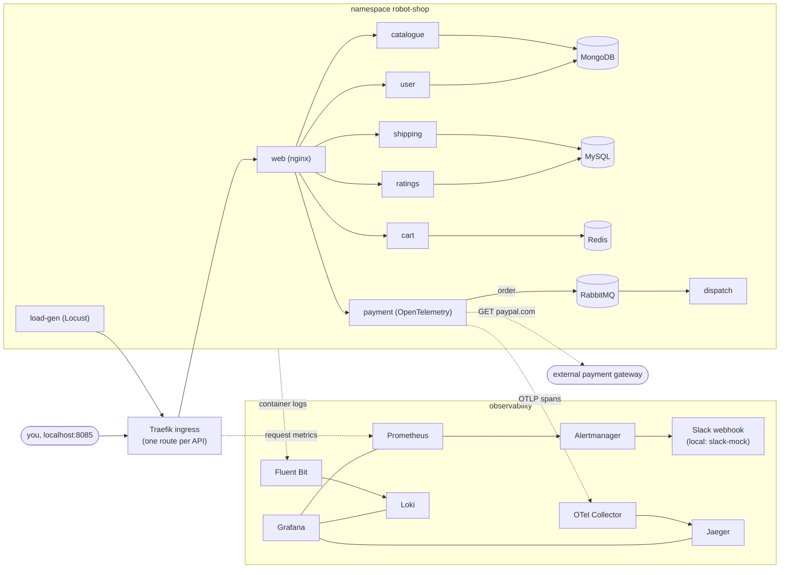

# Capstone 2: "Keep It Running" with Stan's Robot Shop

**Author:** Tivere Madagwa · **Fork of:** [instana/robot-shop](https://github.com/instana/robot-shop) (archived upstream) · **Budget:** $0

This fork runs Stan's Robot Shop on a **local Kubernetes cluster (Minikube)** and adds metrics, logs, traces, an SLO with alerting, and an incident drill with a postmortem. Nothing runs in the cloud: the course allows local results, and the budget for this project is strictly $0. The upstream README is kept [below](#upstream-readme-instanarobot-shop).

## What was built (brief → where it is)

| Brief requirement | Done with | Files | Evidence |
|---|---|---|---|
| Deploy the app with Helm | Upstream chart, cleaned up: images pinned by digest, Instana settings removed, load generator, per-API Ingress, probes and limits fixed | [`K8s/helm/`](K8s/helm/) | [c2-2](docs/evidence/c2-2-deploy.txt), [c2-3a](docs/evidence/c2-3a-traefik.txt) |
| kube-prometheus-stack | Prometheus, Alertmanager, Grafana, kube-state-metrics, node-exporter (chart 92.14.0), sized for 7 GB | [`monitoring/kube-prometheus-stack-values.yaml`](monitoring/kube-prometheus-stack-values.yaml) | [c2-3b](docs/evidence/c2-3b-prometheus.txt) |
| Dashboard: requests, errors, latency for the key services | Traefik ingress gives per-API request/error/latency metrics; 22-panel Grafana dashboard loaded from a ConfigMap | [`monitoring/dashboards/`](monitoring/dashboards/) | [c2-3c](docs/evidence/c2-3c-dashboard.txt), [screenshot](docs/evidence/c2-3c-dashboard.jpg) |
| Logs with Fluent Bit → Loki, searchable by service and level | Fluent Bit DaemonSet with a Lua script that reads the level from 8 different log formats; Loki single binary | [`logging/`](logging/) | [c2-4](docs/evidence/c2-4-logs.txt) |
| Traces with OpenTelemetry → Jaeger, one real trace | `payment` instrumented with the OpenTelemetry SDK; OTel Collector; Jaeger v2 | [`tracing/`](tracing/), [`payment/tracing.py`](payment/tracing.py) | [c2-5](docs/evidence/c2-5-tracing.txt), [screenshot](docs/evidence/c2-5-trace.jpg) |
| Availability SLO + error-budget policy | 99.5 % of `/api` requests without 5xx over 28 days; one-page policy | [`docs/slo.md`](docs/slo.md) | [c2-6](docs/evidence/c2-6-slo-alerting.txt) |
| Alert to Slack with a runbook link | Multi-window burn-rate alerts → Alertmanager → Slack (webhook from a Secret) | [`monitoring/slo/`](monitoring/slo/), [runbook](docs/runbooks/robot-shop-availability.md) | [c2-6](docs/evidence/c2-6-slo-alerting.txt) |
| Incident drill: mitigate, root cause, blameless postmortem | Bad release (catalogue memory limit) → Slack alert → `helm rollback` → fix (readiness probe), verified by replaying the bad release | [`docs/drills/`](docs/drills/) | [postmortem](docs/postmortems/2026-10-27-catalogue-oom.md), [c2-7](docs/evidence/c2-7-incident-drill.txt) |
| README, diagram, demo | This page, [demo script](docs/demo-script.md) | | |

## Architecture



| Namespace | Runs |
|---|---|
| `robot-shop` | the 12 Robot Shop services + load-gen (chart `K8s/helm`, release `robot-shop`) |
| `traefik` | Traefik 3.7 ingress (ClusterIP, reached with a port-forward) |
| `monitoring` | kube-prometheus-stack, Robot Shop dashboard, SLO rules, slack-mock |
| `logging` | Loki 3.6, Fluent Bit 5.1 |
| `tracing` | OpenTelemetry Collector 0.163, Jaeger 2.20 |

## Run it

Needs Docker Desktop with 8 GB of memory, Minikube, kubectl and Helm 4. The cluster uses about 5 GB with everything running.

```bash
alias k='kubectl --context capstone'
minikube start -p capstone --cpus=4 --memory=7168 --keep-context

# 1. Ingress, then the shop
helm install traefik oci://ghcr.io/traefik/helm/traefik --version 42.1.3 \
  -n traefik --create-namespace -f monitoring/traefik-values.yaml
helm install robot-shop K8s/helm -n robot-shop --create-namespace --wait --timeout 25m
# later releases: helm upgrade ... --wait --rollback-on-failure (see the postmortem)

# 2. Metrics, dashboard, SLO, alerting (create the Slack Secret first, see the runbook)
k create namespace monitoring
k -n monitoring create secret generic alertmanager-slack --from-literal=webhook-url='<your Slack webhook URL>'
helm install monitoring oci://ghcr.io/prometheus-community/charts/kube-prometheus-stack \
  --version 92.14.0 -n monitoring -f monitoring/kube-prometheus-stack-values.yaml
k apply -k monitoring/dashboards
k apply -f monitoring/slo/robot-shop-slo-rules.yaml
k apply -f monitoring/slo/slack-mock.yaml      # only when testing without real Slack

# 3. Logs
helm install loki loki --repo https://grafana.github.io/helm-charts --version 7.5.0 \
  -n logging --create-namespace -f logging/loki-values.yaml
helm install fluent-bit fluent-bit --repo https://fluent.github.io/helm-charts \
  --version 0.58.3 -n logging -f logging/fluent-bit-values.yaml

# 4. Traces (see tracing/README.md), then the Grafana datasources
#    ... jaeger, otel-collector, build the payment image, upgrade robot-shop ...
k apply -k monitoring/datasources
```

Then follow the [demo script](docs/demo-script.md).

## Findings

- **Payment is slow because of the external payment gateway.** The dashboard showed payment's p95 latency at 8–10 s. A trace showed why: the call to `https://paypal.com/` (upstream uses the real site as a dummy gateway) takes a median **95 %** of each payment request; the internal calls take 1–10 ms ([c2-5](docs/evidence/c2-5-tracing.txt)).
- **Memory is the tightest resource on a 7 GB cluster.** Shipping (Java), the load generator (Locust's per-URL statistics) and Grafana were each OOMKilled before their limits were fixed; the drill reproduces the same failure on purpose.
- **The drill found three weaknesses**, all fixed or listed: no readiness probe let a crash-looping pod replace a healthy one; releases did not wait; and missing monitoring data (the laptop slept) sent a false RESOLVED to Slack ([postmortem](docs/postmortems/2026-10-27-catalogue-oom.md)).
- **Leftover Instana sensors** in every service keep looking for an agent. Their log lines are labelled `instana_noise="true"` so they can be filtered out instead of being mistaken for errors.

## Changes from upstream and from the brief (honest list)

- **Local, not cloud.** All of this runs on Minikube; nothing was deployed to a cloud provider.
- **Traefik added** in front of `web`: the Robot Shop services do not export request metrics, so the ingress measures requests, errors and latency per API.
- **Starter kits not used.** The instructor's kube-prometheus-stack values, Fluent Bit config and OTel config were not provided, so all configs here are this project's own.
- **Only `payment` is traced** (the brief asks for one instrumented service). Its Instana import was replaced with OpenTelemetry.
- **Jaeger 2.20.0 instead of 2.22.0**, because Grafana's Jaeger datasource cannot search Jaeger 2.21+ ([tracing/README.md](tracing/README.md)).
- **Slack delivery is not verified with a real workspace.** No Slack webhook is configured; alerts go to `slack-mock`, which logs exactly what Slack would receive. Putting a real webhook in the Secret is the only change needed.
- **28-day SLO window:** Prometheus keeps 24 h on this laptop, so the dashboard shows how much of the 28-day budget the last 24 h used.
- **Instana components** (agent, EUM, tracing in the other services) are not used.

## Troubleshooting

| Problem | Fix |
|---|---|
| Pods `OOMKilled` or many restarts at once | `docker stats capstone`; the node is near 7 GB. Scale down something you are not using (`k -n voting-app scale deploy --all --replicas=0`). |
| `helm upgrade monitoring` fails with `etcdserver: request timed out` | The Mac went to sleep mid-upgrade. Re-run the same upgrade. |
| Grafana's Jaeger datasource: `404 Not Found` | Jaeger is newer than 2.20; see [tracing/README.md](tracing/README.md). |
| Fluent Bit not ready right after install | Loki rejects very old log lines it is replaying (`entry too far behind`); it recovers within a minute. |
| Alertmanager pod stuck `ContainerCreating` | The `alertmanager-slack` Secret is missing; create it (runbook, "Slack set-up"). |
| No traces in Jaeger | `k -n robot-shop logs deploy/payment | grep tracing` should say "tracing enabled"; Jaeger keeps traces in memory, so a restart clears them. |
| Shop not reachable | `k -n traefik port-forward svc/traefik 8085:80`, then `http://localhost:8085`. |

## Final checklist

| | Item | Status |
|---|---|---|
| ✅ | App deployed with Helm, all pods ready | chart 1.3.0, release `robot-shop` |
| ✅ | kube-prometheus-stack installed, targets up | see c2-3b |
| ✅ | Dashboard with requests, errors, latency per API (+ screenshot) | 22 panels, all queries return data |
| ✅ | Logs in Loki, searchable by service and level | labels `namespace`, `service`, `level`, `instana_noise` |
| ✅ | One real trace from an instrumented service in Jaeger | `payment`, 5 spans, screenshot |
| ✅ | Availability SLO + one-page error-budget policy | `docs/slo.md` |
| ✅ | Burn-rate alert routed to Slack with a runbook link | verified with slack-mock; real Slack not verified |
| ✅ | Incident drill, mitigation, root cause, blameless postmortem | `docs/postmortems/2026-10-27-catalogue-oom.md` |
| ✅ | README, architecture diagram, demo script | this page, `docs/demo-script.md` |
| ❌ | Cloud deployment | not done: $0 budget, local cluster only (allowed by the instructor) |

---

# Upstream README (instana/robot-shop)

## Sample Microservice Application

Stan's Robot Shop is a sample microservice application you can use as a sandbox to test and learn containerised application orchestration and monitoring techniques. It is not intended to be a comprehensive reference example of how to write a microservices application, although you will better understand some of those concepts by playing with Stan's Robot Shop. To be clear, the error handling is patchy and there is not any security built into the application.

You can get more detailed information from my [blog post](https://www.instana.com/blog/stans-robot-shop-sample-microservice-application/) about this sample microservice application.

This sample microservice application has been built using these technologies:
- NodeJS ([Express](http://expressjs.com/))
- Java ([Spring Boot](https://spring.io/))
- Python ([Flask](http://flask.pocoo.org))
- Golang
- PHP (Apache)
- MongoDB
- Redis
- MySQL ([Maxmind](http://www.maxmind.com) data)
- RabbitMQ
- Nginx
- AngularJS (1.x)

The various services in the sample application already include all required Instana components installed and configured. The Instana components provide automatic instrumentation for complete end to end [tracing](https://docs.instana.io/core_concepts/tracing/), as well as complete visibility into time series metrics for all the technologies.

To see the application performance results in the Instana dashboard, you will first need an Instana account. Don't worry a [trial account](https://instana.com/trial?utm_source=github&utm_medium=robot_shop) is free.

## Build from Source
To optionally build from source (you will need a newish version of Docker to do this) use Docker Compose. Optionally edit the `.env` file to specify an alternative image registry and version tag; see the official [documentation](https://docs.docker.com/compose/env-file/) for more information.

To download the tracing module for Nginx, it needs a valid Instana agent key. Set this in the environment before starting the build.

```shell
$ export INSTANA_AGENT_KEY="<your agent key>"
```

Now build all the images.

```shell
$ docker-compose build
```

If you modified the `.env` file and changed the image registry, you need to push the images to that registry

```shell
$ docker-compose push
```

## Run Locally
You can run it locally for testing.

If you did not build from source, don't worry all the images are on Docker Hub. Just pull down those images first using:

```shell
$ docker-compose pull
```

Fire up Stan's Robot Shop with:

```shell
$ docker-compose up
```

If you want to fire up some load as well:

```shell
$ docker-compose -f docker-compose.yaml -f docker-compose-load.yaml up
```

If you are running it locally on a Linux host you can also run the Instana [agent](https://docs.instana.io/quick_start/agent_setup/container/docker/) locally, unfortunately the agent is currently not supported on Mac.

There is also only limited support on ARM architectures at the moment.

## Marathon / DCOS

The manifests for robotshop are in the *DCOS/* directory. These manifests were built using a fresh install of DCOS 1.11.0. They should work on a vanilla HA or single instance install.

You may install Instana via the DCOS package manager, instructions are here: https://github.com/dcos/examples/tree/master/instana-agent/1.9

## Kubernetes
You can run Kubernetes locally using [minikube](https://github.com/kubernetes/minikube) or on one of the many cloud providers.

The Docker container images are all available on [Docker Hub](https://hub.docker.com/u/robotshop/).

Install Stan's Robot Shop to your Kubernetes cluster using the [Helm](K8s/helm/README.md) chart.

To deploy the Instana agent to Kubernetes, just use the [helm](https://github.com/instana/helm-charts) chart.

## Accessing the Store
If you are running the store locally via *docker-compose up* then, the store front is available on localhost port 8080 [http://localhost:8080](http://localhost:8080/)

If you are running the store on Kubernetes via minikube then, find the IP address of Minikube and the Node Port of the web service.

```shell
$ minikube ip
$ kubectl get svc web
```

If you are using a cloud Kubernetes / Openshift / Mesosphere then it will be available on the load balancer of that system.

## Load Generation
A separate load generation utility is provided in the `load-gen` directory. This is not automatically run when the application is started. The load generator is built with Python and [Locust](https://locust.io). The `build.sh` script builds the Docker image, optionally taking *push* as the first argument to also push the image to the registry. The registry and tag settings are loaded from the `.env` file in the parent directory. The script `load-gen.sh` runs the image, it takes a number of command line arguments. You could run the container inside an orchestration system (K8s) as well if you want to, an example descriptor is provided in K8s directory. For End-user Monitoring ,load is not automatically generated but by navigating through the Robotshop from the browser .For more details see the [README](load-gen/README.md) in the load-gen directory.  

## Website Monitoring / End-User Monitoring

### Docker Compose

To enable Website Monioring / End-User Monitoring (EUM) see the official [documentation](https://docs.instana.io/website_monitoring/) for how to create a configuration. There is no need to inject the JavaScript fragment into the page, this will be handled automatically. Just make a note of the unique key and set the environment variable `INSTANA_EUM_KEY` and `INSTANA_EUM_REPORTING_URL` for the web image within `docker-compose.yaml`.

### Kubernetes

The Helm chart for installing Stan's Robot Shop supports setting the key and endpoint url required for website monitoring, see the [README](K8s/helm/README.md).

## Prometheus

The cart and payment services both have Prometheus metric endpoints. These are accessible on `/metrics`. The cart service provides:

* Counter of the number of items added to the cart

The payment services provides:

* Counter of the number of items perchased
* Histogram of the total number of items in each cart
* Histogram of the total value of each cart

To test the metrics use:

```shell
$ curl http://<host>:8080/api/cart/metrics
$ curl http://<host>:8080/api/payment/metrics
```

